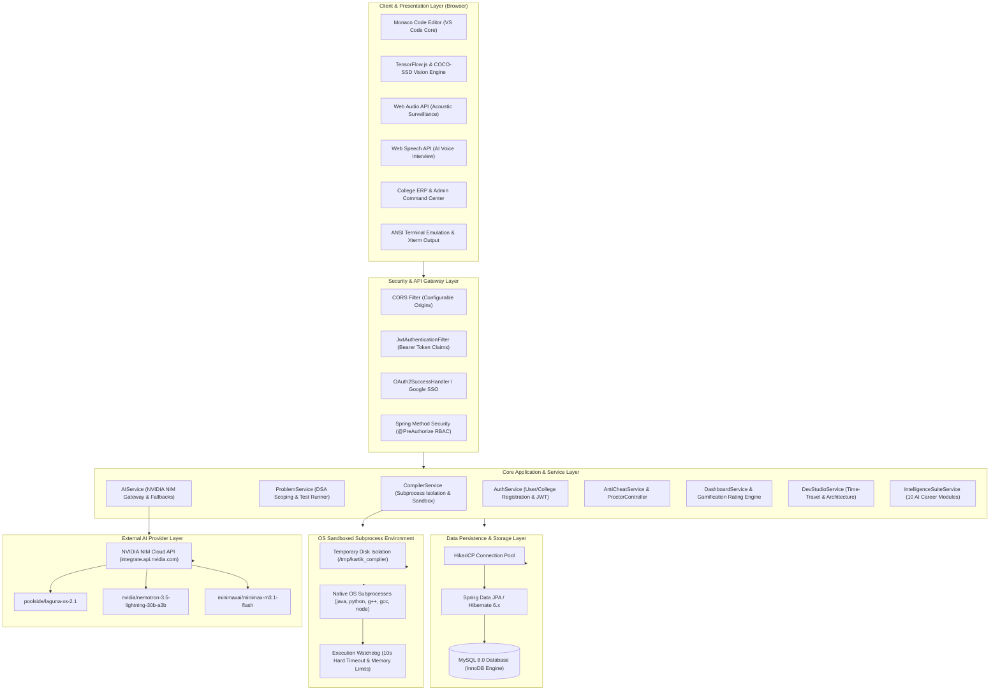
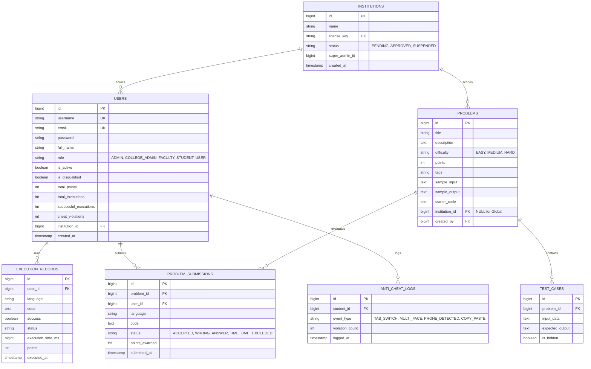
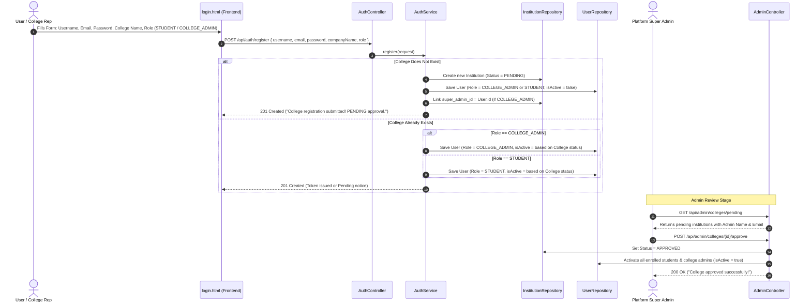
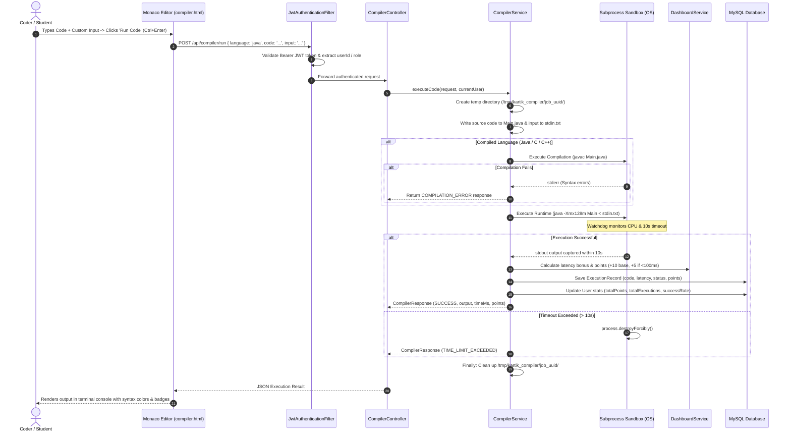
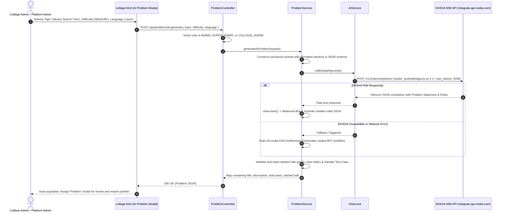
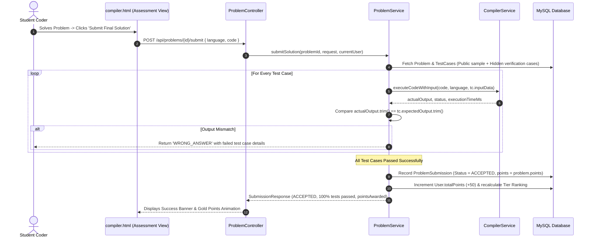
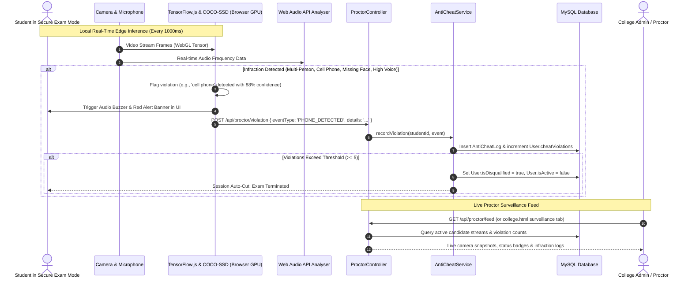

# 🏗️ KartikTerminal: Deep Internal Architecture & End-to-End Workflow

---

## 1. Executive Summary & System Overview

**KartikTerminal** is an enterprise-grade, cloud-native **Online Code Execution Sandbox, Automated Assessment Engine, and AI-Powered Academic Proctoring Ecosystem**. The platform is designed to serve four primary personas:
1. **Students / Independent Coders**: Write, compile, test, and submit algorithmic solutions, participate in proctored college exams, and track progress on real-time gamified leaderboards.
2. **College Admins & Faculty**: Manage institutional departments, create problem statements, schedule coding contests, monitor live student proctoring feeds, and audit student code submissions.
3. **Platform Super Admins**: Maintain global system health, approve/reject pending college registrations, inspect system-wide code execution metrics, and manage user privileges.
4. **Technical Recruiters & Evaluators**: Evaluate verified candidate code, inspect anti-cheat audits, review time-space complexity metrics, and analyze AI-driven candidate reports.

The platform is built on **Spring Boot 3.x (Java 17)**, **Spring Security 6.x**, **MySQL 8.x**, **JWT (HMAC-SHA256)**, **NVIDIA NIM AI Endpoints**, and a **Monaco-powered lightweight frontend**.

---

## 2. Layered Architecture Diagram



---

## 3. Deep Architectural Components Breakdown

### 3.1 Client & Presentation Layer
* **Monaco Editor Integration**: Embedded VS Code editor providing intelligent code completion, bracket colorization, multi-theme support (*Dracula, Monokai, Dark+*), syntax highlighting, and keyboard shortcuts.
* **Proctoring Engine (TensorFlow.js + COCO-SSD)**: Runs locally on the client's GPU via WebGL. Detects multiple persons, mobile phones, books, and missing candidate faces without streaming raw heavy video to the server.
* **Audio Telemetry (Web Audio API)**: Uses `AudioContext` and `AnalyserNode` to compute root-mean-square (RMS) acoustic decibels, flagging continuous whispers or unauthorized voice exchanges.
* **Client-Side Auth Manager (`auth.js`)**: Intercepts outgoing `fetch` calls, dynamically injects `Authorization: Bearer <token>`, decodes JWT claims, and renders role-based interface elements.

---

### 3.2 Security & Authentication Layer
* **Dual Authentication Modes**:
  1. **Google OAuth2**: `oauth2Login()` via Google Identity Services with automatic profile sync and user creation via `OAuth2SuccessHandler`.
  2. **Stateless JWT**: Standard username/email and BCrypt-hashed password authentication generating cryptographic HMAC-SHA256 tokens (`app.jwt.secret`, 24-hour expiration).
* **Role-Based Access Control (RBAC)**:
  * `SUPER_ADMIN` / `ADMIN`: Unrestricted global system access.
  * `COLLEGE_ADMIN` / `FACULTY`: College-scoped access (manage college students, view institution proctor feeds, assign problems, review exam submissions).
  * `STUDENT` / `USER`: Standard access (run compiler, solve assigned and public problems, view personalized dashboard and public leaderboards).
* **Multi-Tenancy Security**: College admins and faculty are strictly isolated to their own college (`currentUser.getInstitution().getId().equals(targetStudent.getInstitution().getId())`). Actions on foreign colleges or global admins are rejected with HTTP 403 Forbidden.

---

### 3.3 Sandboxed Execution Engine (`CompilerService`)
The compiler engine executes untrusted polyglot user code securely without compromising the host machine:
1. **Dynamic File Generation**: Creates a randomized isolated folder in `app.compiler.temp-dir` (e.g. `/tmp/kartik_compiler/code_a1b2c3d4/`).
2. **Source Code Extraction**: Writes user code into proper source filenames (`Main.java`, `script.py`, `solution.cpp`, `main.c`, `app.js`).
3. **Subprocess Invocation (`ProcessBuilder`)**:
   * **Compilation Stage** (for compiled languages: Java, C, C++): Executes compiler binary (`javac`, `g++`, `gcc`) with diagnostic error interception.
   * **Execution Stage**: Spawns runtime with strict resource limits:
     * **Memory Ceiling**: `-Xmx128m` (Java) preventing memory exhaustion attacks.
     * **Timeout Watchdog**: 10-second hard asynchronous interrupt via `process.waitFor(timeout, TimeUnit.SECONDS)`. If exceeded, `process.destroyForcibly()` kills the PID and returns a `TIME_LIMIT_EXCEEDED` status.
     * **Output Truncation**: Standard output stream buffers are capped at 50,000 characters (`app.compiler.max-output`) to eliminate infinite-loop buffer overflow attacks.
4. **Cleanup Guarantee**: A `finally` block recursively deletes temporary source files and compiled binaries.

---

### 3.4 AI Intelligence & Problem Generation Pipeline (`AIService` & `ProblemService`)
* **NVIDIA NIM Integration**: Connects to `https://integrate.api.nvidia.com/v1/chat/completions` using Bearer authentication.
* **Multi-Model Fallback Hierarchy**:
  1. `poolside/laguna-xs-2.1`: Ultra-low latency coding model returning direct, high-fidelity JSON.
  2. `minimaxai/minimax-m3.1-flash`: Fast backup LLM for high-throughput completions.
  3. `nvidia/nemotron-3.5-lightning-30b-a3b`: NVIDIA's advanced reasoning model.
* **Balanced-Brace JSON Parser (`cleanJson`)**: Robust scanner that filters markdown code fences (````json ... ````), skips reasoning tokens, tracks string escaping, and isolates the outer `{ ... }` object without failing on trailing commentary.
* **Dynamic Topic Synthesizer**: If the external AI service encounters network dropouts, `ProblemService` automatically switches to an in-memory algorithmic problem generator covering 15+ DSA domains (Trees, Graphs, DP, Stacks, Queues, Linked Lists, Matrices, Bitwise, Greedy) and generates custom problems for any user-defined topic string.

---

### 3.5 Database & Entity-Relationship Schema



---

## 4. End-to-End System Workflows

---

### Workflow 1: College Registration, Verification & Role Onboarding



---

### Workflow 2: Sandboxed Polyglot Code Execution Lifecycle



---

### Workflow 3: AI Dynamic Problem Generation Lifecycle



---

### Workflow 4: Automated Problem Submission & Multi-Test Grading



---

### Workflow 5: Real-Time AI Proctoring & Anti-Cheat Surveillance



---

## 5. Security & Isolation Threat Model

| Threat Vector | Attack Scenario | KartikTerminal Mitigation Architecture |
| :--- | :--- | :--- |
| **Infinite Loop / Fork Bomb** | User executes `while(true)` or `fork()` bomb | Subprocess executed with **10-second hard watchdog**. Unresponsive processes are forcibly terminated with `process.destroyForcibly()`. |
| **Memory Exhaustion (DoS)** | Program attempts to allocate huge memory heap | Java sub-runtime strictly constrained by JVM argument `-Xmx128m`. OS enforces process memory ceiling. |
| **Output Flooding Attack** | Infinite printing loop (`while(true) print('A')`) | Output stream buffer reader enforces hard cap of `50,000` characters (`app.compiler.max-output`). Excess stream is truncated. |
| **Cross-Tenant Inspection** | College Admin accesses records of another college | Database queries for students and problems are multi-tenant scoped (`institution_id`). Security checks verify caller institution ID against target entity. |
| **Exam Integrity Violations** | Student uses mobile phone, switches tabs, copies code | Client-side **TensorFlow.js COCO-SSD** flags devices and tab switches; clipboard events tracked; infractions recorded in `anti_cheat_logs`; auto-cut termination upon 5 violations. |
| **Privilege Escalation** | Student invokes admin endpoints (`/api/admin/**`) | Spring Security method security `@PreAuthorize("hasAnyRole('ADMIN', 'SUPER_ADMIN', 'COLLEGE_ADMIN')")` validates role directly from cryptographic JWT claims. |

---

## 6. Technology Stack Summary

* **Backend Framework**: Spring Boot 3.2.x (Java 17)
* **Security & Auth**: Spring Security 6.x, JJWT (HMAC-SHA256), Google OAuth2 Client
* **Data Layer**: Hibernate 6.x, Spring Data JPA, MySQL 8.0 (InnoDB), HikariCP
* **Code Editor**: Microsoft Monaco Editor (VS Code Engine)
* **Computer Vision AI**: TensorFlow.js, COCO-SSD MobileNet v2 Model
* **LLM Engine**: NVIDIA NIM Cloud API (`poolside/laguna-xs-2.1`, `nvidia/nemotron-3.5-lightning-30b-a3b`, `minimaxai/minimax-m3.1-flash`)
* **Audio & Voice Processing**: Web Audio API (`AnalyserNode`), Web Speech API (SpeechRecognition & SpeechSynthesis)
* **Build System**: Apache Maven 3.8+ with Maven Wrapper (`mvnw`)
